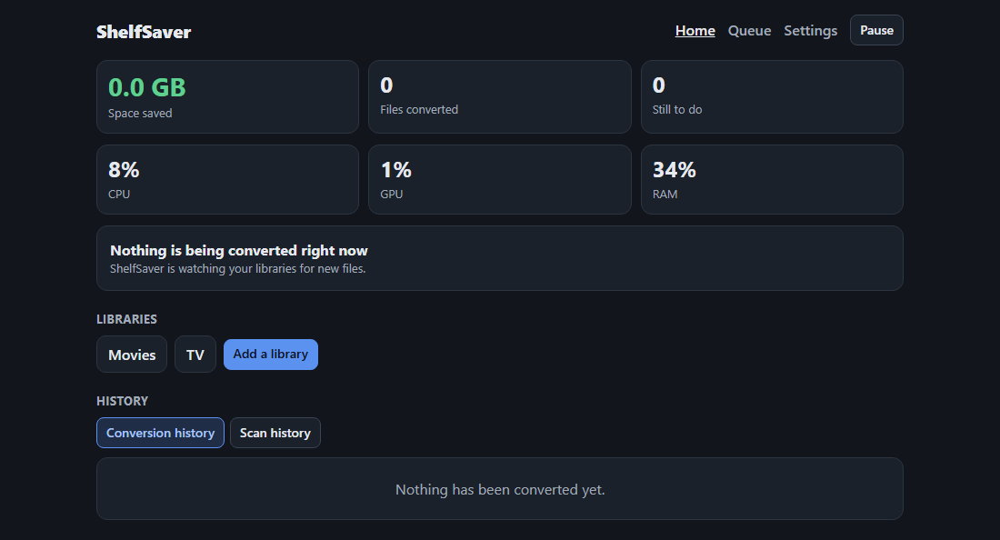
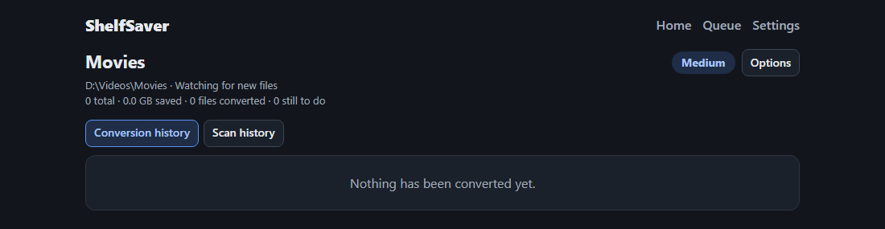
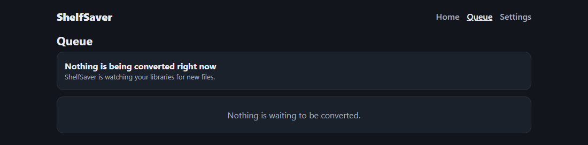
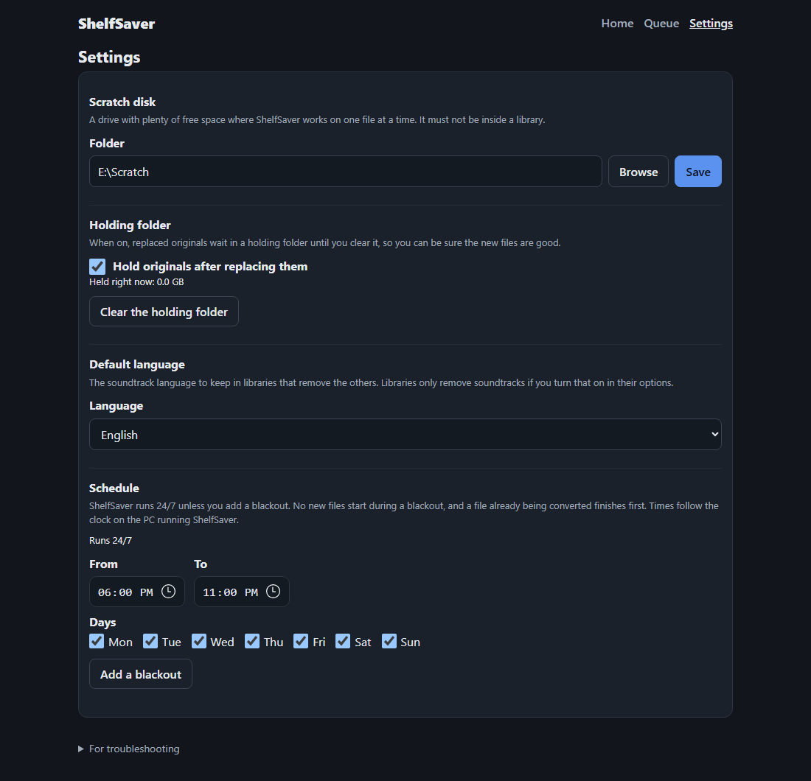

# ShelfSaver

ShelfSaver watches the video folders you choose and shrinks the files that are worth
shrinking by converting them to H.265 on your NVIDIA graphics card. It checks every new file
(length, tracks, plays from start to finish, meaningfully smaller) before it replaces the
original, and it never removes anything you did not agree to.

It runs on one Windows 11 PC with an NVIDIA graphics card, and you use it from a web page.

**This app is dumb on purpose.** There are no advanced settings and no secret menu of encoder
knobs. I just wanted to free up some disk space without earning a degree in video compression.
If you came for the fancy version, this isn't it, and I'm thrilled about that.

## Screenshots

These show a fresh install with nothing converted yet, and the folder names are made up.

**Home**



**Library**



**Queue**



**Settings**



## What it does

- Treats each folder you add as a library, and picks up new files as they arrive.
- Decides for each video whether converting it is worthwhile, and skips the rest.
- Has one setting for how hard to compress: Low, Medium or High.
- Shows each library's space saved, plus every file's old and new size and format.
- Builds new files on a scratch disk you choose, and swaps them in once they pass the checks.
- Runs 24/7 unless you add blackout times, when no new files start.
- Can keep replaced originals in a holding folder until you clear them.
- Can remove soundtracks that aren't in your default language (English unless you change it),
  except on dubbed movies. This is off unless you turn it on.
- Can shrink H.265 files that are far bigger than they need to be. It tests a short sample first
  and only converts when the file would come out at least 25% smaller. HDR files are left as
  they are. This is off unless you turn it on for a library.
- Offers logs and status over a read-only MCP connection.

## Install

You need Windows 11, an NVIDIA graphics card and an internet connection.

1. Download or copy this folder to the PC.
2. Open PowerShell as administrator (right-click PowerShell, choose "Run as administrator").
3. Run:

   ```powershell
   powershell -ExecutionPolicy Bypass -File .\scripts\install.ps1
   ```

The script installs Python and FFmpeg if they are missing, puts the program in
`C:\Program Files\ShelfSaver`, sets it to start with the PC, opens its port on
Domain, Private and Public networks, and prints the web address (port 8642) at the end.

Your settings, history and login live in `C:\ProgramData\ShelfSaver`. Only administrators
can open that folder.

To update, get the newer copy of this folder and run the same command again. The new version
is built first, then swapped in; if anything goes wrong the old version is put back. Your data
is left alone. Run setup from a folder outside `C:\Program Files\ShelfSaver`.

## Uninstall

In PowerShell as administrator:

```powershell
powershell -ExecutionPolicy Bypass -File .\scripts\install.ps1 -Uninstall
```

This stops ShelfSaver and removes the startup task, the firewall rule and the program folder.
Your settings and history are kept. To delete those too, add `-RemoveData`. Your video
libraries, holding folders and scratch disks are never touched.

## Running on Linux (preview)

ShelfSaver runs on Linux as a service (installer below), by hand, or in Docker. Converting
needs either an NVIDIA card (NVENC, the default) or an Intel GPU (Quick Sync, see below) with a
matching FFmpeg. The test suite and an end-to-end check of the real app have been run on Debian
and Ubuntu; NVENC has run on Linux through the 12 GPU tests (RTX 5070 Ti, FFmpeg 7.1.5 inside the
image), Quick Sync on Linux on an Intel UHD 770.

**FFmpeg version matters for HDR.** FFmpeg 6.1 (the one in Ubuntu 24.04) silently drops the HDR10
mastering and light-level metadata when encoding with `hevc_nvenc`; 7.1.5, 8.0.1 and 9.0.2 keep it.
Use 7.1 or newer. The Docker image does.

### Install as a service (Debian and Ubuntu)

From this folder:

```bash
sudo ./scripts/install.sh --media /srv/media
```

The script installs FFmpeg and Python if they are missing, puts the program in `/opt/shelfsaver`,
keeps settings, history and the login in `/var/lib/shelfsaver`, and sets ShelfSaver up as a systemd
service. The service starts at boot, restarts itself if it stops, and runs as the owner of the media
folder (never as root), so converted files keep their owner. The script also picks NVIDIA or Intel,
whichever works, opens port 8642 if ufw or firewalld is running, and prints the web address at the
end.

To update, get the newer copy of this folder and run the same command again. You can leave out
`--media` this time: the folders already set are kept. The new version is built first, then
swapped in. If it doesn't start, the old version and its settings are put back.

| Option | What it does |
|---|---|
| `--media DIR` | Folder your libraries are in (repeat for several). Needed the first time. |
| `--scratch DIR` | Folder a scratch disk may be in (repeat for several). Needed before you can choose a scratch disk in Settings. |
| `--user NAME` | Account to run as. Default: the owner of the first media folder. |
| `--encoder nvenc\|qsv` | Skip the check and use this encoder. |
| `--uninstall` | Remove the service, the firewall rule and the program. Settings and history are kept. |
| `--remove-data` | With `--uninstall`: also delete the settings, history and login. |

- **Logs:** `journalctl -u shelfsaver -f`, plus `/var/lib/shelfsaver/logs/shelfsaver.log`, which the
  web page shows.
- **Drivers:** the script doesn't install GPU drivers. For NVIDIA, install the NVIDIA driver. For
  Intel, see "Intel Quick Sync" below.
- **The account needs write access to the top folder of the drive** your libraries are on, because
  ShelfSaver keeps its `incoming` and `holding` folders there.
- **What has been run:** Ubuntu 26.04 (under WSL) with an RTX 4060 Ti. Each of these was run:
  - install, then a real NVENC conversion swapped in with the owner kept;
  - start at boot;
  - update;
  - a broken update rolled back to the old version with byte-identical settings;
  - uninstall, with and without `--remove-data`.

  It has not been run on Debian or with Intel Quick Sync yet.
- Your video libraries, holding folders and scratch disks are never touched by the script.

### Run it by hand

Install FFmpeg and Python 3.10 or newer, then from this folder:

```bash
python3 -m venv .venv && .venv/bin/pip install -e .
SHELFSAVER_DATA=/var/lib/shelfsaver SHELFSAVER_MEDIA_ROOTS=/media SHELFSAVER_SCRATCH_ROOTS=/scratch .venv/bin/python -m shelfsaver
```

| Setting | What it does |
|---|---|
| `SHELFSAVER_MEDIA_ROOTS` | Folders libraries may be in (separate several with `:`). **Required on Linux.** |
| `SHELFSAVER_SCRATCH_ROOTS` | Folders the scratch disk may be in. Required before a scratch disk can be chosen. |
| `SHELFSAVER_DATA` | Where settings, history and the login are kept. Default `~/.local/share/ShelfSaver`. |
| `SHELFSAVER_PORT` | Web page port. Default 8642. |
| `SHELFSAVER_HOST` | Network address the web page listens on. Default `0.0.0.0` (every network). Use `127.0.0.1` to allow only this machine, e.g. behind a reverse proxy on the same machine. |
| `SHELFSAVER_TRUSTED_PROXIES` | Reverse proxies whose `X-Forwarded-For` / `X-Forwarded-Proto` headers are believed (comma-separated addresses or networks, or `*`). Default: none. See "Security notes" below. |
| `SHELFSAVER_ENCODER` | `nvenc` (default) or `qsv`. Works on Windows and Linux. |
| `SHELFSAVER_QSV_DEVICE` | Quick Sync only. Linux: the render node, default `/dev/dri/renderD128`. Windows: the DirectX adapter number, only needed if the PC has more than one GPU. |

The same names can go in `config.json` in the data folder as `media_roots`, `scratch_roots`,
`port`, `host`, `trusted_proxies`, `encoder` and `qsv_device`; the environment wins if both are set.

### Docker (Unraid, or any Linux host)

The `Dockerfile` builds an image with FFmpeg 7.1 (both `hevc_nvenc` and `hevc_qsv`), Intel's media
driver and ShelfSaver. It is about 950 MB, almost all of it FFmpeg's libraries.

```bash
docker build -t shelfsaver .
# Intel Quick Sync:
docker run -d --name shelfsaver -p 8642:8642 --device /dev/dri \
  -e SHELFSAVER_ENCODER=qsv -e PUID=99 -e PGID=100 \
  -v /path/to/appdata:/config -v /path/to/media:/media -v /path/to/scratch:/scratch shelfsaver
# NVIDIA (needs the NVIDIA Container Toolkit; leave SHELFSAVER_ENCODER unset):
docker run -d --name shelfsaver -p 8642:8642 --gpus all -e PUID=99 -e PGID=100 \
  -v /path/to/appdata:/config -v /path/to/media:/media shelfsaver
```

| Setting | What it does |
|---|---|
| `/config` | Settings, history, login and the log. Keep it on persistent storage. |
| `/media` | Where the libraries are (`SHELFSAVER_MEDIA_ROOTS` already points here). |
| `/scratch` | Optional fast work disk (`SHELFSAVER_SCRATCH_ROOTS` already points here). |
| `PUID` / `PGID` | The user and group ShelfSaver runs as. Default 99 / 100 (Unraid's nobody / users). Use the owner of your library so nothing else loses access to converted files. |
| `UMASK` | Permissions for files the container itself creates. Default 022. Converted files copy the original's permissions instead. |

- The container starts as root only to fix the ownership of `/config` and to join the group that
  owns the GPU device (read from the device, since its number differs between hosts), then drops to
  `PUID:PGID`. Starting it with Docker's `user:` option instead also works.
- Logs go to the container's output (`docker logs`) and also to the log file the web page reads.
- `docker stop` shuts down in order and exits 0. The health check asks `/healthz`, which
  also proves the database can be read, so a hung app is noticed and not only a closed port.
- **Intel's non-free media driver:** the image includes `intel-media-va-driver-non-free` (needed for
  Quick Sync) under Intel's licence. The licence text is in the image at
  `/usr/share/doc/intel-media-va-driver-non-free/copyright`.
- **Unraid:** `docker/shelfsaver-unraid.xml` is a template; copy it to
  `/boot/config/plugins/dockerMan/templates-user/`. Its image name (`ghcr.io/jasonadams1301-web/shelfsaver`)
  will work once the image is published; until then build it yourself as above. For NVIDIA add `--runtime=nvidia` to Extra Parameters and remove the
  `/dev/dri` device.
- **What has been run** (the image started the normal way, as 99:100, then driven through its own
  web API: one library per quality level, a synthetic H.264 file in each, converted, verified and
  swapped in by ShelfSaver itself):
  - *Quick Sync*, a Linux server with an Intel UHD 770 (`--device /dev/dri`): all three levels converted
    to H.265, played start to finish, and kept the original's owner and permissions. The health
    check reported healthy and `docker stop` exited 0.
  - *NVIDIA*, RTX 5070 Ti through the NVIDIA Container Toolkit (`--gpus all`) under WSL2: the same
    result. The 12 NVENC tests also pass inside the container.
  - Not run: a real Unraid install from the template, or an NVIDIA GPU on a native Linux host (WSL2
    exposes the GPU through `/dev/dxg`, not `/dev/nvidia*`). On Windows, use the Windows install
    rather than Docker.

### Intel Quick Sync (QSV)

Set `SHELFSAVER_ENCODER=qsv`. Needs an Intel GPU and an FFmpeg built with `hevc_qsv`.

- **Linux:** FFmpeg needs Intel's media driver and the oneVPL runtime (on Debian:
  `intel-media-va-driver-non-free libvpl2 libmfx-gen1.2`; the driver is in the non-free
  component). ShelfSaver must be able to open the render node, so in Docker pass the device in
  (`--device /dev/dri/renderD128`).
- **Windows:** uses D3D11, selected automatically. Checked on an Intel Arc Pro B70 in a PC that
  also has an AMD card: the Intel GPU was found on its own, so `SHELFSAVER_QSV_DEVICE` is only
  needed to choose between two Intel GPUs. The installer does not switch to Quick Sync yet: add
  `"encoder": "qsv"` to `C:\ProgramData\ShelfSaver\config.json`, then restart ShelfSaver.
- **Checked on Windows (Intel Arc Pro B70):** ShelfSaver's own command and checks passed on 8-bit
  MKV and MP4 (`hvc1` tag), interlaced (deinterlaced) and 10-bit HDR10 sources, with the HDR10
  colour tags, mastering display and light level data kept. The full test suite also passed there.
- **Checked on Linux (Intel UHD 770):** ShelfSaver itself scanned, converted, verified and replaced
  an 8-bit MKV. The 10-bit, MP4 (`hvc1` tag, HDR colour tags) and deinterlace cases were run as the
  same ffmpeg commands directly, not yet through ShelfSaver's own conversion.
- **Quality numbers were measured.** Low/Medium/High map to Quick Sync quality 17/19/21 (lower is a
  better picture and a bigger file). On 12 clips from 6 H.264 TV episodes (streaming-quality
  sources), that came out at about 65% / 47% / 36% of the original size, with VMAF scores of
  92.6 / 91.7 / 90.8 (VMAF compares the new file to the original: 100 is identical, around 90 is very good).
  Quick Sync's scale is not NVENC's: 17 looks like NVENC's Medium (26) and 21 looks like its High (30).
  Savings depend a lot on the picture: a grainy source can shrink little or not at all, and is then
  skipped. Use `scripts/make_compare_clips.py --encoder qsv` on your own files to check.
- **The GPU tile on the home page shows a dash** for Quick Sync: Intel offers no simple reading that
  doesn't need extra permissions, and a made-up number would mislead.

Things that differ from Windows, and why:

- **Folders must be named up front.** On Windows you pick a drive. A Linux machine has one big
  folder tree, and the folder picker would otherwise let anyone who signs in browse all of it.
  Libraries and the picker are limited to the media roots (symlinks are followed, so a link
  inside a root cannot lead outside it).
- **A library can't be the top of a mounted volume.** ShelfSaver keeps its `incoming` and
  `holding` folders at the top of the volume a library is on, so replacing a file is a single
  rename on one filesystem and can never be cut off halfway. In Docker, map a parent folder
  (such as your whole media share to `/media`) and add libraries inside it.
- **Nothing is ever overwritten.** Linux's rename silently replaces an existing file, unlike
  Windows. ShelfSaver asks the kernel to refuse instead (`renameat2` with `RENAME_NOREPLACE`)
  and falls back to checking first on filesystems that can't.
- **Files in use.** Linux lets a file be replaced while another program has it open, so a
  replaced file is never "waiting, in use" the way it can be on Windows.
- **Stopping.** `SIGTERM` (what `docker stop` and systemd send) stops the worker in order.
  If ShelfSaver is killed outright (`kill -9`), ffmpeg is not tied to it as it is on Windows, and
  may finish on its own into the scratch folder. It never writes to a library.
- **No HTTPS yet.** The web page is plain HTTP on every network interface, as on Windows, so the
  password and session cookie cross your network unencrypted. Keep it on a trusted network or put
  it behind a reverse proxy that adds HTTPS. Binding to one address is planned.
- **Logs.** Logs go to `logs/shelfsaver.log` in the data folder, not to the terminal.
- **Unraid.** Tested on Unraid's share layer: file identity survives renames and the no-replace
  rename works, which the replace step depends on.

## Security notes

ShelfSaver has a password (set on first visit), allows 5 failed logins a minute per address and
signs the browser in with a cookie that JavaScript cannot read. For anything beyond a trusted home
network:

- **Use HTTPS in front of it** (a reverse proxy). The page itself speaks plain HTTP, so a password
  typed on an untrusted network can be read. Over HTTPS the sign-in cookie is marked `Secure`
  automatically, so the browser never sends it over plain HTTP.
- **Tell it which proxy to believe** with `SHELFSAVER_TRUSTED_PROXIES` (the proxy's address as
  ShelfSaver sees it; in Docker often the network's gateway such as `172.17.0.1`). Without it the
  `X-Forwarded-*` headers are ignored, so behind a proxy the cookie is not marked `Secure` and the
  login limit sees the proxy's address, shared by every visitor, instead of each visitor's. Do not
  use `*` unless only the proxy can reach ShelfSaver's port.
- Every page and answer carries a Content-Security-Policy (the browser only runs ShelfSaver's own
  script and refuses to be framed), `X-Content-Type-Options`, `X-Frame-Options` and
  `Referrer-Policy`. API answers are marked not to be cached, because one contains the MCP token.
- `GET /healthz` answers `{"ok": true}` without a login, for health checks and uptime monitors.
  It returns 503 if the database cannot be read and reveals nothing else.

## Stopping ShelfSaver

ShelfSaver restarts itself if it is stopped (and checks every few minutes), so ending the task in
Task Manager will not keep it stopped. To stop it until you want it back, in PowerShell as
administrator:

```powershell
Disable-ScheduledTask -TaskName ShelfSaver
Stop-ScheduledTask -TaskName ShelfSaver
```

To turn it back on: `Enable-ScheduledTask -TaskName ShelfSaver` then `Start-ScheduledTask -TaskName ShelfSaver`.

## Compare Low, Medium and High

This tool makes short clips from one of your files at each setting. The installer puts it at
`C:\Program Files\ShelfSaver\scripts\make_compare_clips.py`. Run it from PowerShell as administrator:

```powershell
& "C:\Program Files\ShelfSaver\venv\Scripts\python.exe" "C:\Program Files\ShelfSaver\scripts\make_compare_clips.py" --source "D:\Media\Movies\Example.mkv" --start 600 --seconds 30 --out "D:\Clips"
```

(From a development copy of this folder, `scripts\make_compare_clips.py` works the same way.)

This writes `Example Original.mkv`, `Example Low.mkv`, `Example Medium.mkv` and
`Example High.mkv` into the output folder and prints how big each one is. The output folder
must not be inside the folder of the source video. The source is never changed.

## Development

```powershell
python -m venv .venv
.venv\Scripts\python -m pip install -e ".[dev]"
.venv\Scripts\python -m pytest
```

Tests marked `gpu` need an NVIDIA graphics card. The tests also run on Linux
(`python -m pytest -m "not gpu"`, with `ffmpeg` and `git` installed); the few that check
Windows-only behaviour, such as exclusive file locks, are skipped there and marked in the code.

## Licence

Apache License 2.0. See `LICENSE`.
